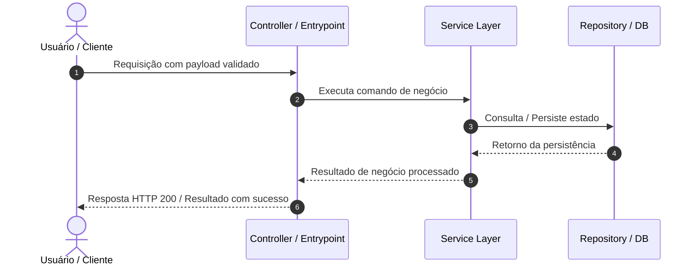
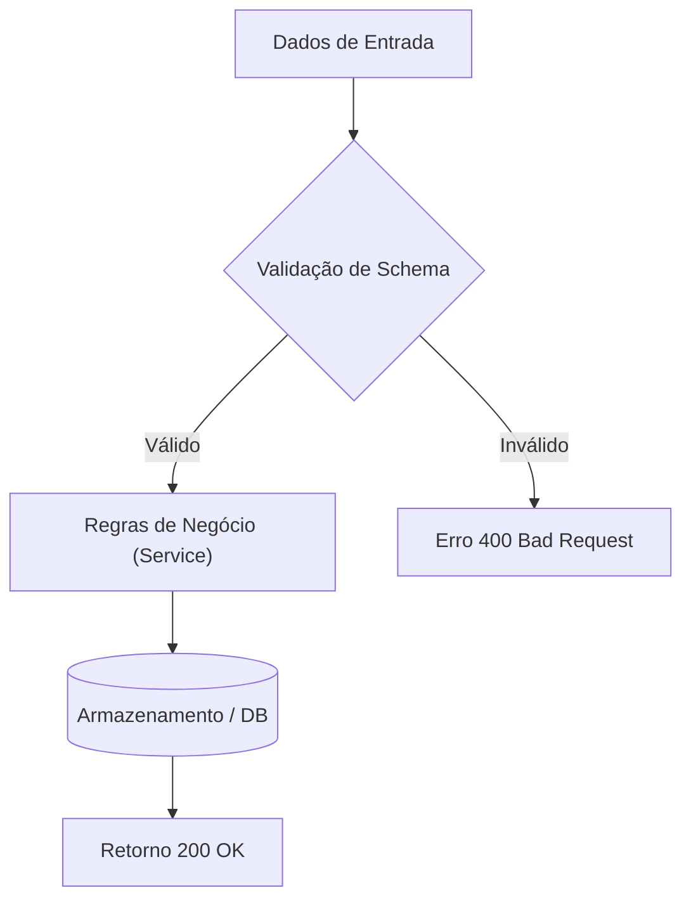

# SDD: exemplo-autenticacao
> **Documento de Design de Software (Software Design Document / Technical Spec)**  
> **Estágio:** 02-SDD | **Baseado no PRD:** `01-prd.md` | **Data:** 2026-10-18

---

## 1. Visão Geral da Arquitetura & Decisões Técnicas
- **Stack & Dependências:** Node.js / TypeScript, bibliotecas utilizadas e versões.
- **Padrão Arquitetural:** Ex.: Camadas (Controller -> Service -> Repository), Clean Architecture, Ports & Adapters.
- **Princípios Chave:** Responsabilidade única, baixo acoplamento, tipagem estrita, fail-fast.

---

## 2. Diagramas de Arquitetura & Fluxo (Mermaid)

### 2.1. Fluxo de Execução (Sequência)


### 2.2. Diagrama de Estados ou Componentes


---

## 3. Modelo de Dados & Tipagem de Domínio

```typescript
// Contratos e tipos de domínio da funcionalidade

export interface ExemploAutenticacaoRequest {
  id: string;
  name: string;
  metadata?: Record<string, unknown>;
}

export interface ExemploAutenticacaoResponse {
  success: boolean;
  data: {
    id: string;
    status: 'pending' | 'active' | 'completed';
    createdAt: string;
  };
}

export type ExemploAutenticacaoError = 
  | { code: 'INVALID_PAYLOAD'; message: string; details?: unknown }
  | { code: 'NOT_FOUND'; message: string }
  | { code: 'INTERNAL_ERROR'; message: string };
```

---

## 4. Contratos de API & Interfaces de Entrada/Saída

| Método / Operação | Caminho / Assinatura | Entrada (Payload) | Saída Sucesso | Códigos de Erro |
| :--- | :--- | :--- | :--- | :--- |
| `POST` | `/api/v1/exemplo-autenticacao` | `ExemploAutenticacaoRequest` | `201 Created` | `400`, `401`, `422` |
| `GET` | `/api/v1/exemplo-autenticacao/:id` | `params: { id: string }` | `200 OK` | `404`, `500` |

---

## 5. Decisões de Arquitetura (ADRs)

### ADR-001: Escolha da Abordagem Técnica
- **Contexto:** Necessidade de implementar a funcionalidade com alto desacoplamento e suporte a testes automatizados.
- **Decisão:** Adotar injeção de dependências e tipagem explícita sem tipos `any`.
- **Alternativas Consideradas:** Funções globais com efeitos colaterais (descartadas pela dificuldade de teste e manutenibilidade).
- **Consequências Positivas:** Alta testabilidade, contratos claros, refatoração segura.
- **Consequências Negativas:** Mais código boilerplate inicial.

---

## 6. Casos Extremos (Edge Cases) & Tratamento de Erros
- **Entrada nula ou indefinida:** Validar na camada de borda e rejeitar com mensagem explicativa.
- **Concorrência ou duplicação:** Garantir idempotência através de chave única ou transação atômica.
- **Falha de serviço externo:** Implementar timeout de 5s e retries com exponential backoff (máx. 3 tentativas).

---

## 7. Estratégia de Testes (TDD Readiness)
- **Testes Unitários:** Foco total nos Services e nas regras de negócio (sem I/O real).
- **Testes de Integração:** Validar integração entre Controller, Services e Mock de persistência.
- **Fixtures & Cenários de Teste Obrigatórios:**
  - Caso feliz (Happy Path)
  - Validação de entrada inválida (Unprocessable Entity)
  - Erro de permissão / recurso não encontrado
  - Timeouts e tratamento de exceções não previstas

---

> 🔒 **Controle da Esteira:** Não avance para `03-tasks` sem que todos os contratos de tipo e diagramas estejam fechados.
