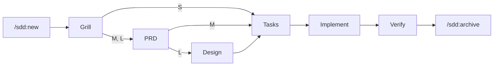

# Esteira SDD para Claude Code

Plugin do Claude Code para desenvolver com **Spec-Driven Development (SDD)**. Toda mudança de comportamento passa pelas mesmas etapas, com aprovação humana entre elas:

1. é interrogada (Grill);
2. é especificada;
3. é quebrada em tarefas com teste antes da implementação;
4. é implementada por subagentes com TDD;
5. é verificada com evidências.

Funciona em qualquer projeto, novo ou existente, interno ou de cliente, em qualquer stack. Padrões de front-end, back-end e infraestrutura entram como **perfis opcionais**.

---

## Sumário

1. [Por que usar](#1-por-que-usar)
2. [Inspirações](#2-inspirações)
3. [Instalação](#3-instalação)
4. [Início rápido](#4-início-rápido)
5. [Conceitos](#5-conceitos)
6. [O fluxo, etapa por etapa](#6-o-fluxo-etapa-por-etapa)
7. [Comandos](#7-comandos)
8. [Formatos: IDs, critérios, tarefas e specs vivas](#8-formatos-ids-critérios-tarefas-e-specs-vivas)
9. [Perfis de padrões](#9-perfis-de-padrões)
10. [Testes](#10-testes)
11. [Economia de tokens](#11-economia-de-tokens)
12. [O que é garantido por código](#12-o-que-é-garantido-por-código)
13. [Configuração (`.sdd/config.json`)](#13-configuração-sddconfigjson)
14. [CLI e integração contínua](#14-cli-e-integração-contínua)
15. [Adoção em projeto legado e em projetos de clientes](#15-adoção-em-projeto-legado-e-em-projetos-de-clientes)
16. [Customização](#16-customização)
17. [Perguntas frequentes e solução de problemas](#17-perguntas-frequentes-e-solução-de-problemas)
18. [Desenvolvimento do plugin](#18-desenvolvimento-do-plugin)

---

## 1. Por que usar

Agentes de código escrevem rápido, mas sem uma especificação acordada eles:
- preenchem lacunas com suposições;
- fazem mais (ou menos) do que foi pedido;
- declaram "pronto" sem prova.

A esteira resolve isso com quatro mecanismos:

| Problema | Como a esteira trata |
| :-- | :-- |
| Requisito ambíguo | **Grill**: interrogatório técnico antes de qualquer documento, uma pergunta por vez |
| Agente codifica antes de entender | **Gate de edição**: o hook bloqueia código de produção até as tarefas serem aprovadas |
| Agente se autoaprova | **Aprovação humana**: só `/sdd:approve`, digitado por você, avança uma etapa |
| "Pronto" sem prova | **Rastreabilidade e verificação**: todo critério de aceite precisa de tarefa e de teste com o seu ID, e o parecer final exige evidência executada |
| Cerimônia demais para ajuste pequeno | **Porte S/M/L**: ajuste pequeno pula PRD e design |
| Custo alto de tokens | Saída de testes resumida, testes focados no TDD, revisão por fatia, modelo mais barato para revisar |

## 2. Inspirações

| Fonte | O que foi aproveitado |
| :-- | :-- |
| Matt Pocock (*grill-me*, *tracer bullets*) | Grill com uma pergunta por vez e resposta recomendada; fatias verticais finas |
| GitHub Spec Kit | Constituição do projeto; marcação `[P]` de tarefas paralelizáveis |
| OpenSpec | Specs vivas por capacidade, deltas ADICIONADOS/MODIFICADOS/REMOVIDOS, arquivamento |
| TLC Spec-Driven | O porte define a profundidade; pirâmide de testes nas tarefas |
| Superpowers | Subagente por unidade de trabalho, revisão em duas etapas, evidência antes de afirmar |
| Kiro / EARS | Critérios de aceite verificáveis ("QUANDO ... o sistema DEVE ...") |
| Esteira v1 (esta) | Grill em 5 eixos, totalizador obrigatório nas estimativas, perfis de front-end, back-end e infra |

## 3. Instalação

### 3.1 Preparar uma máquina nova (passo a passo)

**1. Node.js 18 ou superior.** O motor da esteira roda em Node e não tem dependências npm.

```bash
node --version
```

Se não tiver, instale a versão LTS em https://nodejs.org (ou com o gerenciador de pacotes do sistema).

**2. Git**, para clonar a esteira e os projetos.

```bash
git --version
```

**3. Claude Code, com login feito.** Instale conforme a documentação oficial (https://code.claude.com/docs), abra uma vez e entre com sua conta:

```bash
claude --version
claude
```

**4. Instalar o plugin da esteira.** Escolha uma das opções:

**Opção A: pelo GitHub** (usa a branch padrão do repositório, `main`)

```bash
claude plugin marketplace add DouglasDeCastroAlmeida/sddEsteiraPropria
claude plugin install sdd@sdd-esteira
```

**Opção B: por um clone local** (serve para qualquer branch ou versão, e para máquinas sem acesso ao GitHub a partir do Claude Code)

```bash
git clone https://github.com/DouglasDeCastroAlmeida/sddEsteiraPropria.git ~/ferramentas/sddEsteiraPropria
cd ~/ferramentas/sddEsteiraPropria
git checkout main
claude plugin marketplace add ~/ferramentas/sddEsteiraPropria
claude plugin install sdd@sdd-esteira
```

Na opção B, o plugin é lido direto da pasta. Para atualizar, rode `git pull` nela e abra uma sessão nova do Claude Code. Para usar outra versão, faça `git checkout` da branch ou tag desejada (ex.: `v1.0.0` é a versão original).

**5. Conferir a instalação.**

```bash
claude plugin list
claude plugin details sdd@sdd-esteira
```

Deve aparecer `sdd@sdd-esteira` como `enabled`, com 12 skills, 3 agentes e 3 hooks.

**6. Usar num projeto.**

| Situação | O que fazer |
| :-- | :-- |
| Projeto que ainda não usa a esteira | Abra o Claude Code na pasta do projeto e rode `/sdd:init` |
| Projeto que já tem `.sdd/` versionado (ex.: clonado de outra máquina) | Só abra o Claude Code na pasta. O hook de início reinstala o motor em `.sdd/bin/` e mostra as mudanças ativas. Rode `/sdd:status` para continuar de onde parou |
| Rodar o CLI sem o Claude Code (terminal ou CI) | `node .sdd/bin/sdd.mjs status` dentro do projeto |

**7. Se algo der errado.**

| Sintoma | Causa provável | Solução |
| :-- | :-- | :-- |
| `/sdd:init` não aparece | Plugin não instalado ou sessão aberta antes da instalação | `claude plugin list`; feche e abra o Claude Code |
| `node: command not found` nos comandos da esteira | Node fora do PATH | Instale o Node 18+ e reabra o terminal |
| `marketplace add` pelo GitHub falha | Sem acesso ao GitHub, repositório privado ou branch errada | Use a opção B (clone local) |
| Edições bloqueadas logo de início | É o gate: não há mudança aprovada | `/sdd:new <pedido>` ou, em projeto legado, `gate.mode: "warn"` (veja a seção 15) |

### 3.2 Gerenciar o plugin

Os mesmos comandos funcionam dentro do Claude Code com `/plugin ...`.

| Ação | Comando |
| :-- | :-- |
| Ver componentes e custo em tokens | `claude plugin details sdd@sdd-esteira` |
| Atualizar (opção A) | `claude plugin marketplace update sdd-esteira` e depois `claude plugin update sdd@sdd-esteira` (vale na próxima sessão) |
| Atualizar (opção B) | `git pull` na pasta do clone e abrir uma sessão nova |
| Desinstalar | `claude plugin uninstall sdd@sdd-esteira` e, se quiser, `claude plugin marketplace remove sdd-esteira` |

Ao atualizar, o hook de início de sessão copia o motor novo para `.sdd/bin/` de cada projeto. Seus templates e perfis customizados não são sobrescritos. Ao desinstalar, a pasta `.sdd/` dos projetos continua lá: specs e histórico são seus.

### 3.3 Versões

| Versão | Onde | O que é |
| :-- | :-- | :-- |
| `v1.0.0` | tag `v1.0.0` | Versão original (CLI TypeScript, skill para Antigravity, infraestrutura Hostinger e WhatsApp) |
| `2.0.0` | este README | Plugin do Claude Code |

Para consultar a v1 sem mudar nada: `git show v1.0.0:README.md` ou `git checkout v1.0.0` num clone.

## 4. Início rápido

```text
/sdd:init
```
Cria `.sdd/` e lê o código (ou entrevista você, em projeto novo). Depois escreve a constituição, detecta os comandos de teste e lint e oferece os perfis que combinam com a stack.

```text
/sdd:new Permitir login com Google na tela de entrada
```
O agente explora o código, propõe o porte (aqui, provavelmente **M**) e começa o Grill.

A partir daí, o ciclo se repete em cada etapa:
1. O agente conduz a etapa e grava o artefato em `.sdd/changes/001-login-com-google/`.
2. Ele valida o artefato e mostra um resumo.
3. Você revisa e digita `/sdd:approve`.
4. Ele segue para a próxima etapa.

Ao final:

```text
/sdd:archive
```
Aplica o que mudou nas specs vivas (`.sdd/specs/`), move a mudança para o histórico e atualiza o `CHANGELOG.md`.

A qualquer momento:

```text
/sdd:status
```

**Modelos de prompt prontos** para projeto novo, projeto em andamento, feature, bug e retomada: [docs/PROMPTS.md](docs/PROMPTS.md).

## 5. Conceitos

| Conceito | O que é |
| :-- | :-- |
| **Constituição** | `.sdd/constitution.md`: regras invioláveis do projeto (princípios, stack, comandos, Definition of Done, proibições, segurança, perfis adotados) |
| **Perfil** | Conjunto opcional de padrões (ex.: `web-react`) copiado para a constituição |
| **Mudança** | Uma unidade de trabalho (`.sdd/changes/NNN-slug/`) com seus artefatos e estado |
| **Porte** | S, M ou L; define quais etapas a mudança percorre |
| **Etapa (estágio)** | grill, prd, design, tasks, implement, verify, done |
| **Gate** | Validação automática do artefato da etapa + aprovação humana |
| **Spec viva** | `.sdd/specs/<capacidade>.md`: como o sistema se comporta hoje, atualizada a cada mudança arquivada |
| **Fatia** | Grupo de tarefas que entrega um comportamento de ponta a ponta; unidade de implementação e revisão |

### Portes

| Porte | Quando | Etapas |
| :-- | :-- | :-- |
| **S** | Ajuste localizado, poucos arquivos, comportamento claro, sem mudança de dados ou contrato público; correções de bug | grill → tasks → implement → verify |
| **M** | Feature ou mudança de comportamento com requisitos a negociar | grill → prd → tasks → implement → verify |
| **L** | Decisão de arquitetura, modelo de dados, integração externa ou risco alto | grill → prd → design → tasks → implement → verify |

Na dúvida, o agente escolhe o maior e você pode trocar.



### Estrutura no projeto

```text
.sdd/
  config.json            gate, comandos, perfis, revisão, qualidade, estimativas
  constitution.md        regras do projeto + perfis adotados
  specs/<capacidade>.md  specs vivas
  changes/NNN-slug/      mudança em andamento
    00-grill.md  01-prd.md  02-design.md  03-tasks.md  04-verify.md
    specs/<capacidade>.md   deltas das specs vivas
    meta.json              estado (só o CLI altera)
  archive/AAAA-MM-DD-NNN-slug/   mudanças concluídas
  bin/                   motor e CLI (atualizados pelo plugin)
  templates/             templates, perfis e guia de testes (customizáveis)
  runs/                  saída completa do último "sdd run" de cada comando (fora do git)
```

Versione `.sdd/` no git. O `/sdd:init` cria `.sdd/.gitignore` para `runs/` e `.gate-state.json`.

## 6. O fluxo, etapa por etapa

### Grill (`00-grill.md`)
Arquiteto cético, sem escrever código. Uma pergunta por vez, sempre com a resposta recomendada pelo agente. O que o código, a constituição ou as specs vivas respondem, ele descobre sozinho. Cobre 5 eixos:
1. necessidade e valor;
2. falhas e timeouts;
3. concorrência e idempotência;
4. segurança e permissões;
5. rollback em menos de 2 minutos.

**Gate:**
- nada pendente de preenchimento;
- seções de perguntas, decisões e fora de escopo preenchidas;
- toda pergunta (`### P1. ...`) com resposta do usuário (`- Resposta: ...`) ou fonte no código (`- Fonte: ...`); `PENDENTE` ou "a confirmar" bloqueia;
- ao menos uma decisão `D-01`;
- no porte S, critérios de aceite verificáveis.

Cada pergunta fica `PENDENTE` no arquivo e o agente encerra o turno esperando você. Se quiser acelerar, diga "aceito todas as recomendações restantes": o aceite em lote fica registrado em cada resposta.

### PRD (`01-prd.md`), portes M e L
Trata do **o quê** e do **porquê**, nunca do como. Cada requisito vira um bloco `### REQ-001` com critérios `AC-001.1` testáveis.

**Gate:**
- seções obrigatórias preenchidas;
- todo requisito tem critério;
- todo critério usa Dado/Quando/Então ou "QUANDO ... DEVE".

### Design (`02-design.md`), porte L
Trata do **como**. O agente pesquisa primeiro como o código já resolve problemas parecidos e segue esses padrões e os perfis adotados. O documento cobre:
- abordagem e componentes afetados;
- contratos e modelo de dados;
- ADRs;
- riscos;
- estratégia de testes.

**Gate:** seções preenchidas (ou `N/A — motivo`) e ao menos um `ADR-001`.

### Tasks (`03-tasks.md`)
Fatias verticais, com teste antes da implementação, estimativa por tarefa e tabela com **TOTALIZADOR GERAL**.

**Gate:**
- toda tarefa tem tipo e estimativa;
- todo critério tem uma tarefa `TEST-*`;
- referências e dependências existem;
- avisa quando uma `IMPL` vem antes do teste do mesmo critério.

### Implement
O agente principal orquestra; o trabalho vai para subagentes, fatia por fatia:
1. `sdd-implementer` faz o ciclo TDD (red → green → refactor);
2. `sdd-reviewer` revisa em duas etapas: primeiro se cumpre a spec, depois a qualidade de código e testes;
3. reprovou: volta ao implementer, até 2 ciclos. Depois disso, o impasse vai para você.

Tudo que for fora da spec para a implementação e volta para você decidir.

**Gate:** todas as tarefas `[x]`.

### Verify (`04-verify.md`)
O `sdd-auditor`:
- roda testes, lint, typecheck, e2e, cobertura e auditoria de dependências (os que estiverem configurados);
- gera a matriz critério → tarefa → teste;
- revisa testes, segurança e desvios de escopo;
- emite um parecer.

Nos portes M/L, o agente também escreve os deltas das specs vivas.

**Gate:**
- seções preenchidas;
- parecer **APROVADO**;
- todo critério encontrado em algum arquivo de teste.

### Archive
Aplica os deltas nas specs vivas. Em caso de conflito, nada é gravado. Depois move a mudança para `archive/` e adiciona uma entrada no `CHANGELOG.md`.

## 7. Comandos

| Comando | O que faz |
| :-- | :-- |
| `/sdd:init` | Prepara o projeto, escreve a constituição, detecta comandos e oferece perfis |
| `/sdd:new <pedido>` | Abre uma mudança, propõe o porte e inicia o Grill |
| `/sdd:grill` | Interrogatório técnico |
| `/sdd:prd` | Requisitos e critérios de aceite |
| `/sdd:design` | Design técnico com ADRs |
| `/sdd:tasks` | Tarefas, fatias e estimativa |
| `/sdd:implement` | Implementação por subagentes com TDD e revisão |
| `/sdd:verify` | Verificação final com evidências |
| `/sdd:approve` | **Sua** aprovação da etapa atual (o agente não consegue invocar) |
| `/sdd:archive` | Specs vivas, histórico e CHANGELOG |
| `/sdd:status` | Etapa, pendências do gate, modo de revisão e progresso |

Depois de cada `/sdd:approve`, o agente já segue para o comando da próxima etapa. Você só precisa chamar os outros comandos para retomar uma mudança numa sessão nova.

## 8. Formatos: IDs, critérios, tarefas e specs vivas

| Item | Formato | Exemplo |
| :-- | :-- | :-- |
| Decisão | `- **D-01** ...` | `- **D-01** Só Google nesta versão.` |
| Requisito | `### REQ-001: nome` | `### REQ-001: Entrar com Google` |
| Critério de aceite | `- **AC-001.1** ...` | `- **AC-001.1** Dado um usuário sem conta, quando entra com Google, então a conta é criada.` |
| ADR | `### ADR-001: título` | `### ADR-001: OAuth via biblioteca oficial` |
| Tarefa | `- [ ] T-001 [P] [TIPO] descrição (~20 min) {AC-...} deps: T-...` | ver abaixo |

```text
### Fatia 1: criar conta com Google (AC-001.1)
- [ ] T-001 [TEST-UNIT] Teste "AC-001.1: cria conta" falhando (~20 min) {AC-001.1}
- [ ] T-002 [IMPL] Criar conta via Google (~30 min) {AC-001.1} deps: T-001

### Fatia 2: falha do provedor (AC-001.2)
- [ ] T-003 [P] [TEST-INT] Google fora do ar mostra erro (~35 min) {AC-001.2}
- [ ] T-004 [IMPL] Tratar falha do provedor (~1h) {AC-001.2} deps: T-003
```

**Tipos de tarefa:** `SETUP`, `TEST-CONTRACT`, `TEST-UNIT`, `TEST-INT`, `TEST-UI`, `TEST-E2E`, `CHECK-SMOKE`, `IMPL`, `REFACTOR`, `DOCS`. Sem estimativa explícita, vale o piso do tipo em `config.json > estimates`.

**Testes citam o ID do critério**, no nome (`it('AC-001.1: cria conta')`) ou, em linguagens onde o nome não aceita `-` e `.`, numa docstring ou comentário. É isso que a rastreabilidade procura.

**Delta de spec viva** (`specs/<capacidade>.md` dentro da mudança):

```markdown
## ADICIONADOS
### Requisito: Login com Google
O sistema DEVE permitir entrar com uma conta Google.
- Cenário: Dado um usuário sem conta, quando entra com Google, então a conta é criada.

## MODIFICADOS
### Requisito: Duração da sessão
(texto completo atualizado; o nome precisa ser igual ao da spec viva)

## REMOVIDOS
### Requisito: Login por SMS
```

## 9. Perfis de padrões

Perfis trazem padrões prontos para quem desenvolve. Ficam em `.sdd/templates/profiles/` e são **opcionais**: o `/sdd:init` recomenda os que combinam com a stack do projeto e você escolhe quais aplicar.

```bash
node .sdd/bin/sdd.mjs profile list
node .sdd/bin/sdd.mjs profile add web-react
```

Aplicar um perfil:
- copia o conteúdo para a seção **Perfis adotados** da constituição;
- registra o perfil em `config.json > profiles`.

A partir daí, design, implementação, revisão e auditoria seguem esses padrões. Reaplicar atualiza o bloco sem duplicar.

**Regra de convivência:** se o projeto já usa outra coisa (outro design system, ORM ou pipeline), **o que existe prevalece**. A divergência é registrada como decisão no Grill ou como ADR. Isso evita, por exemplo, introduzir MUI num projeto de cliente que já usa outro design system.

### `web-react`: front-end React

| Tema | Padrão |
| :-- | :-- |
| Componentes | **Uma** base por projeto, registrada em ADR: **MUI** (aplicações gerais), **Ant Design** (corporativo, telas densas de dados) ou **Tailwind CSS** + componentes headless (identidade própria) |
| Estilo | Tokens de tema para cores, tipografia e espaçamento; acabamento segundo o **Impeccable Style** |
| Cores | Paletas do **Color Hunt** ou **Adobe Color** convertidas em tokens; contraste **WCAG 2.2 AA** (4,5:1 texto, 3:1 interface) |
| Ícones | **Lucide** como padrão; **Lordicon** só em momentos de destaque; **Heroicons** e **React Icons** como apoio |
| Acessibilidade | HTML semântico, teclado, foco visível, labels e erros anunciados |
| Código | TypeScript strict, Zod nas bordas, responsivo a partir de 360 px |
| Testes | Testing Library por papel/rótulo; Playwright para jornadas críticas; `@axe-core/playwright` sem violações graves |
| Claude Code | MUI MCP para documentação; Playwright MCP ou Chrome DevTools MCP só para depurar falhas |

### `api-node`: back-end Node.js

| Tema | Padrão |
| :-- | :-- |
| Arquitetura | Monólito modular; Controller → Service → Repository; dependências injetadas |
| Entrada/saída | Zod nas bordas; erros tipados; `Idempotency-Key` em POST repetível |
| Resiliência | Timeout padrão de 5 s; retry exponencial com jitter só em operação idempotente; circuit breaker em dependência crítica |
| Dados | PostgreSQL com Prisma ou Drizzle (MongoDB/Mongoose com ADR); migrações compatíveis com rollback; tenant de fonte confiável |
| Segurança | Segredos por variável de ambiente; autorização no back-end; consultas parametrizadas; logs sem dados pessoais |
| Testes | Contrato com schemas; unitário no Service; integração com Supertest e banco real; teste de isolamento entre clientes |
| Claude Code | `/security-review` em mudanças sensíveis |

### `infra-hostinger`: Docker em VPS

| Tema | Padrão |
| :-- | :-- |
| Containers | Multi-stage, usuário não-root, healthcheck, tag imutável |
| Rede | Caddy com TLS automático; só 80/443 públicos; detectar proxy da Hostinger (Traefik) antes de subir outro |
| Segredos | `.env` só no servidor; GitHub Secrets no pipeline |
| Deploy | GitHub Actions: testes → build → push → deploy por SSH idempotente |
| Rollback | Menos de 2 minutos voltando a tag anterior; migrações compatíveis; backup antes do deploy |
| Testes | `CHECK-SMOKE` subindo o Compose e chamando as rotas de saúde |

### Criar um perfil próprio

Crie `.sdd/templates/profiles/<nome>.md` no projeto. Para todos os projetos, crie `templates/profiles/<nome>.md` num fork do plugin. Formato:

```markdown
# Perfil: Nome legível

> **Quando usar:** uma linha dizendo para que stack ou situação serve.

## Seção
...
```

`sdd profile list` passa a mostrá-lo e `sdd profile add <nome>` o aplica.

## 10. Testes

A qualidade do produto final depende mais dos testes do que de qualquer outra etapa. A esteira trata isso em quatro camadas.

### Estrutura (no planejamento)
- Todo critério de aceite precisa de uma tarefa `TEST-*`. O gate de tasks bloqueia se faltar.
- Escolha da **camada mais baixa** que prova o critério: contrato, unitário, integração, UI, E2E, smoke. E2E só para jornadas críticas.
- Ordem: teste antes da implementação, por fatia.

### Disciplina (na implementação)
- **Red → Green → Refactor** por critério. O teste precisa falhar **pela asserção**, não por erro de import ou setup.
- Correção de bug começa por um teste que reproduz o bug (regressão).

### Qualidade do teste (na revisão)

Regras do `.sdd/templates/testing-guide.md`, cobradas pelo `sdd-reviewer` e pelo `sdd-auditor`:
- comportamento observável, não detalhes internos;
- um motivo para falhar por teste; Arrange/Act/Assert;
- mock só na fronteira (terceiros, relógio, aleatoriedade), nunca do próprio código nem do banco em teste de integração;
- determinismo; sem `sleep`/espera fixa; dados criados pelo próprio teste;
- caminhos de erro, permissão negada e limites decididos no Grill;
- teste instável é defeito: corrigir a causa, não aumentar timeout.

### Prova (na verificação)
- **Rastreabilidade:** `sdd trace` procura o ID de cada critério nos arquivos de teste.
- **Cobertura** (opcional): `commands.coverage` + `quality.coverageMin`. É tratada como sinal, não como meta.
- **Segurança de dependências** (opcional): `commands.security` (ex.: `npm audit --audit-level=high`).
- Parecer só com evidência executada na sessão.

## 11. Economia de tokens

Testes e revisões são onde mais se gasta contexto. Medidas embutidas:

| Fonte de gasto | Medida | Como configurar |
| :-- | :-- | :-- |
| Saída longa de testes, lint e build | `sdd run <comando>` mostra só o resumo (final da saída + linhas de erro); a saída completa fica em `.sdd/runs/<comando>.log` | `run.tailLines`, `run.maxFailureLines`; `--full` quando precisar |
| Suíte inteira a cada passo do TDD | `sdd run testFocused <arquivos>` durante red/green; suíte completa só no fechamento da fatia | `commands.testFocused` com `{files}` |
| Reporters verbosos | Reporter curto e parada na primeira falha | ex.: `--reporter=dot`, `pytest -q -x` |
| Revisão a cada tarefa | Revisão **por fatia** nos portes M/L e **uma só no fim** no porte S | `review.mode`: `auto`, `per-slice`, `per-task`, `final` |
| Modelo caro em todas as etapas | `sdd-reviewer` e `sdd-auditor` usam `model: sonnet`; o `sdd-implementer` herda o modelo da sessão | edite o `model:` em `agents/*.md` (`haiku`, `sonnet`, `opus`, `inherit`) |
| Contexto principal inchado | Trabalho pesado em subagentes; o orquestrador passa trechos (linhas das tarefas, texto dos critérios), não documentos inteiros | — |
| Capturas de tela de navegador | MCP de navegador só para depurar uma falha; verificação de UI é a suíte Playwright | — |
| Cerimônia em ajuste pequeno | Porte S pula PRD e design | — |
| Leitura de documentação | Guia de testes e perfis são lidos pelos subagentes só quando necessários | — |

**Custo fixo do plugin:** cerca de 486 tokens por sessão (descrições das skills e dos agentes). O conteúdo de cada skill só entra no contexto quando ela é usada, entre ~140 e ~1.100 tokens. Os hooks não consomem contexto. Medido com `claude plugin details sdd@sdd-esteira`.

**Custo medido de um fluxo real** (Claude Code 2.1.304, projeto Node pequeno, mudança porte S com 4 tarefas e 7 critérios de aceite, do `/sdd:init` ao `/sdd:archive`): **cerca de US$ 1,45 no total**.

| Etapa | Custo aproximado |
| :-- | --: |
| `/sdd:init` (análise do projeto e constituição) | US$ 0,24 |
| `/sdd:new` + Grill | US$ 0,11 |
| Tarefas e estimativa | US$ 0,12 |
| Implementação (subagente + revisão final) | US$ 0,39 |
| Verificação (auditor; achou e corrigiu um teste que passava por acidente) | US$ 0,45 |
| Aprovações, bloqueios e arquivamento | US$ 0,14 |

Os valores variam com o modelo da sessão, o tamanho do projeto e o número de ciclos de correção. Use `/cost` ao fim de cada mudança e ajuste `review.mode` e os modelos dos subagentes conforme o resultado.

## 12. O que é garantido por código

Três hooks do plugin transformam regras em bloqueios:

| Garantia | Hook | Comportamento |
| :-- | :-- | :-- |
| Sem código antes da aprovação | `PreToolUse` (Edit, Write, MultiEdit, NotebookEdit) | Bloqueia arquivos fora de `gate.allow` se nenhuma mudança estiver em `implement` ou `verify` |
| Estado e motor protegidos | `PreToolUse` | Bloqueia edição de `meta.json`, de `.sdd/bin/` e de `.sdd/.gate-state.json` |
| Gate não se afrouxa sozinho | `PreToolUse` | Bloqueia qualquer edição que altere a seção `gate` de `.sdd/config.json` (modo e caminhos liberados); o resto do arquivo continua editável |
| Aprovação humana | `UserPromptSubmit` + `PreToolUse` (Bash) | `/sdd:approve` digitado por você libera **um** `approve`; sem ele, ou com `--force`, o comando é negado |
| Contexto da esteira | `SessionStart` | Atualiza `.sdd/bin` e informa ao agente as mudanças ativas |

A validação dos artefatos é feita pelo CLI e roda em todo `approve`. Uma etapa nunca avança com erro, exceto por `--force`, que fica registrado no histórico e só pode ser usado por você no terminal.

**Limites conhecidos:**
- O gate não vê escrita de arquivos via shell (`sed -i`, `>`). A skill proíbe esse contorno, mas não há bloqueio técnico.
- Se o hook `UserPromptSubmit` não registrar o `/sdd:approve` (por exemplo, numa versão futura do Claude Code), o gate tenta reconhecê-lo no transcript da sessão. Se nenhum dos dois funcionar, a aprovação é recusada (falha segura) e pode ser feita no terminal: `node .sdd/bin/sdd.mjs approve`.
- Emergência: a variável de ambiente `SDD_GATE` (`off`, `warn` ou `strict`) sobrepõe o modo do `config.json`. Defina-a ao iniciar o Claude Code (ex.: `SDD_GATE=off claude`).

## 13. Configuração (`.sdd/config.json`)

```json
{
  "version": 2,
  "language": "pt-BR",
  "gate": {
    "mode": "strict",
    "allow": [".sdd/**", "**/*.md", "docs/**", ".claude/**", ".github/**"]
  },
  "commands": {
    "test": "npx vitest run --reporter=dot",
    "testFocused": "npx vitest run {files} --reporter=dot",
    "lint": "npx eslint . --quiet",
    "typecheck": "npx tsc --noEmit",
    "e2e": "npx playwright test --reporter=line",
    "coverage": "npx vitest run --coverage --reporter=dot",
    "security": "npm audit --audit-level=high"
  },
  "profiles": ["web-react", "api-node"],
  "review": { "mode": "auto" },
  "quality": { "coverageMin": 80 },
  "run": { "timeoutSeconds": 900, "tailLines": 25, "maxFailureLines": 60 },
  "tests": {
    "include": ["**/*.test.*", "**/*.spec.*", "**/test_*.py", "**/*_test.go", "tests/**", "e2e/**"],
    "exclude": ["node_modules/**", "dist/**", ".sdd/**", "coverage/**"]
  },
  "estimates": {
    "SETUP": 10, "TEST-CONTRACT": 10, "TEST-UNIT": 20, "TEST-INT": 35, "TEST-UI": 30,
    "TEST-E2E": 50, "CHECK-SMOKE": 15, "IMPL": 20, "REFACTOR": 15, "DOCS": 10
  }
}
```

| Chave | Significado |
| :-- | :-- |
| `gate.mode` | `strict` bloqueia; `warn` só avisa; `off` desliga |
| `gate.allow` | Caminhos editáveis sem mudança aprovada (globs) |
| `commands.*` | Comandos usados por `sdd run`, pelos subagentes e pelo auditor; vazio = não configurado |
| `commands.testFocused` | Roda só os arquivos informados; `{files}` é substituído (sem `{files}`, os arquivos vão no fim) |
| `profiles` | Perfis aplicados (mantido por `sdd profile add`) |
| `review.mode` | `auto` (S: final; M/L: por fatia), `per-slice`, `per-task`, `final` |
| `quality.coverageMin` | Mínimo de cobertura conferido pelo auditor (`null` = não conferir) |
| `run.*` | Tempo máximo e tamanho do resumo do `sdd run` |
| `tests.include/exclude` | Onde a rastreabilidade procura os IDs dos critérios |
| `estimates` | Piso em minutos por tipo de tarefa |

Exemplos de `commands` para outras stacks:

| Stack | `test` | `testFocused` |
| :-- | :-- | :-- |
| Python (pytest) | `pytest -q` | `pytest -q -x {files}` |
| Go | `go test ./...` | `go test {files}` |
| Java (Maven) | `mvn -q test` | `mvn -q test -Dtest={files}` (passe nomes de classe, não caminhos) |
| .NET | `dotnet test --nologo -v q` | `dotnet test --nologo -v q --filter {files}` (passe a expressão de filtro) |

## 14. CLI e integração contínua

O motor fica em `.sdd/bin/sdd.mjs` e funciona sem o plugin (terminal, CI, outro editor).

```bash
node .sdd/bin/sdd.mjs status [mudança] [--json]
node .sdd/bin/sdd.mjs new "título" --size S|M|L
node .sdd/bin/sdd.mjs validate [mudança] [--stage x]
node .sdd/bin/sdd.mjs approve [mudança] [--by nome] [--note texto] [--force]
node .sdd/bin/sdd.mjs estimate [mudança] [--json]
node .sdd/bin/sdd.mjs trace [mudança] [--json]
node .sdd/bin/sdd.mjs run <test|testFocused|lint|typecheck|e2e|coverage|security> [arquivos] [--full]
node .sdd/bin/sdd.mjs profile list | add <nome>
node .sdd/bin/sdd.mjs archive [mudança]
```

`[mudança]` aceita o ID completo (`001-login-com-google`), o número (`001`) ou o slug. Sem argumento, usa a única mudança ativa.

`validate`, `trace` e `run` saem com código 1 quando há pendência ou falha. Exemplo no GitHub Actions:

```yaml
- name: Gates da esteira SDD
  run: |
    for d in .sdd/changes/*/; do
      [ -f "$d/meta.json" ] && node .sdd/bin/sdd.mjs validate "$(basename "$d")" || exit 1
    done
```

## 15. Adoção em projeto legado e em projetos de clientes

**Projeto legado:**
1. `/sdd:init` com o código existente. A constituição descreve o que já existe.
2. Comece com `"gate": { "mode": "warn" }`: o agente é avisado, mas não bloqueado.
3. Use porte S para os primeiros ajustes; a equipe aprende o fluxo com pouca cerimônia.
4. Specs vivas crescem a cada mudança arquivada. Não é preciso documentar o sistema inteiro antes.
5. Quando o fluxo estiver natural, troque para `strict`.

**Projetos de clientes:**
- O plugin não depende de serviços ou ferramentas internas; roda com Claude Code e Node.js.
- Os perfis só são aplicados se combinarem com a stack do cliente. Padrões do cliente vão para a constituição como regra.
- `.sdd/` pode ser entregue junto com o código como documentação viva (specs, decisões, histórico).
- Licença MIT: pode ser usado e adaptado em projetos comerciais.

## 16. Customização

| O que | Onde | Observação |
| :-- | :-- | :-- |
| Templates dos artefatos | `.sdd/templates/*.md` do projeto | Nunca sobrescritos pelo plugin. Mantenha os títulos de seção exigidos pelo gate |
| Perfis | `.sdd/templates/profiles/` | Veja [Criar um perfil próprio](#criar-um-perfil-próprio) |
| Guia de testes | `.sdd/templates/testing-guide.md` | Lido pelos subagentes |
| Constituição | `.sdd/constitution.md` | Mudanças nela devem passar por uma mudança porte S |
| Modelos dos subagentes | `agents/*.md` (fork do plugin) | Campo `model:` |
| Para todos os projetos | Fork deste repositório | Instale o fork como marketplace |

## 17. Perguntas frequentes e solução de problemas

**O agente diz que a edição foi bloqueada.**
É o gate: não há mudança em `implement`. Rode `/sdd:status` para ver em que etapa está. Para mexer em algo fora da esteira, ajuste `gate.allow` ou use `SDD_GATE=off` conscientemente.

**`/sdd:approve` foi recusado.**
- Se o motivo for "gate bloqueado", o artefato tem erros: o agente mostra a lista e corrige; depois aprove de novo.
- Se for "decisão humana", o registro da aprovação não chegou: digite `/sdd:approve` como única mensagem ou aprove no terminal.

**Quero pular uma etapa.**
Escolha um porte menor no `/sdd:new`. Em emergência, `node .sdd/bin/sdd.mjs approve --force` no seu terminal. Fica registrado no histórico.

**O `trace` diz que um critério não tem teste, mas tem.**
O ID literal (`AC-001.1`) precisa aparecer no arquivo de teste, e o arquivo precisa casar com `tests.include`.

**Posso usar com outra IA ou editor?**
O CLI e os artefatos são agnósticos. Os comandos `/sdd:*`, os subagentes e os hooks são do Claude Code.

**Os testes do meu projeto demoram.**
Configure `testFocused` e deixe a suíte completa para o fechamento de fatia e a verificação. Ajuste `run.timeoutSeconds` se necessário.

## 18. Desenvolvimento do plugin

```text
.claude-plugin/   plugin.json (manifesto) e marketplace.json
skills/           um diretório por comando /sdd:* + a skill sdd-flow
agents/           sdd-implementer, sdd-reviewer, sdd-auditor
hooks/            hooks.json, gate.mjs, prompt.mjs, session-start.mjs
scripts/          lib.mjs (motor) e sdd.mjs (CLI)
templates/        artefatos, perfis (profiles/) e guia de testes
tests/            testes do motor, CLI e hooks
```

```bash
npm test
```

Testes com o runner nativo do Node, sem dependências. Antes de publicar uma versão:
1. `claude plugin validate --strict .`, `claude plugin validate --strict .claude-plugin/plugin.json`, `claude plugin validate skills` e `claude plugin validate agents`.
2. Rode um fluxo completo num projeto de teste carregando o plugin só naquela sessão: `claude --plugin-dir /caminho/do/repo`. Em modo headless, encadeie as etapas com `claude -p "/sdd:approve" --resume <id-da-sessão> --plugin-dir ...`.
3. Atualize `version` em `.claude-plugin/plugin.json`, `ENGINE_VERSION` em `scripts/lib.mjs` e o `CHANGELOG.md`.

## Licença

MIT.
