# 🚀 SDD Flow - Esteira Profissional de Spec-Driven Development

> **A esteira padrão definitiva de engenharia de software orientada a especificações para desenvolvimento assistido por IA e execução autônoma 24/7.**

---

## 🏛️ Inspirações de Ouro Integradas

A **Esteira SDD** foi projetada a partir da fusão harmoniosa das melhores práticas de engenharia de software da atualidade, eliminando conflitos e garantindo o máximo de rigor técnico:

1. **Matt Pocock (Grill & Refinamento Socrático):** Interrogatório técnico pré-PRD desafiando premissas contra falhas catastróficas, timeouts, concorrência e estratégias de rollback.
2. **Spec-Kit (`.specify` & Constituição Viva):** Organização limpa na IDE, padronização em `constitution.md` (Stack: React, Node.js, Postgres/MongoDB, MUI, AntD, Impeccable Style, Lucide/Lordicon).
3. **TLC (Test-Led Coding):** Rigor inviolável de testes em camadas (Contratos Zod, Domínio BDD/Gherkin, Integração de API/Banco, E2E Playwright e Smoke Test em Docker).
4. **Open Spec (Sistema de Archives & Changelog):** Transferência imutável de funcionalidades liberadas para `.sdd/archive/YYYY-MM-DD-<feature>/`, mantendo o repositório limpo e alimentando o `CHANGELOG.md`.

---

## 🔄 O Ciclo de Vida dos 5 Estágios

```mermaid
flowchart LR
    G["00. GRILL<br/>(Matt Pocock)"] --> P["01. PRD<br/>(Requisitos)"]
    P --> S["02. SDD<br/>(Arquitetura)"]
    S --> T["03. TASKS<br/>(Estimativa & TLC)"]
    T --> I["04. IMPL<br/>(TDD 24/7 VPS)"]
    I --> A["05. AUDIT<br/>(Auditoria)"]
    A --> R["📦 ARCHIVE<br/>(Open Spec)"]

    style G fill:#fff3e0,stroke:#e65100,stroke-width:2px;
    style P fill:#e1f5fe,stroke:#0277bd,stroke-width:2px;
    style S fill:#ede7f6,stroke:#512da8,stroke-width:2px;
    style T fill:#fff8e1,stroke:#fbc02d,stroke-width:2px;
    style I fill:#e8f5e9,stroke:#388e3c,stroke-width:2px;
    style A fill:#fce4ec,stroke:#c2185b,stroke-width:2px;
    style R fill:#e0f2f1,stroke:#00695c,stroke-width:2px;
```



---

## 🛠️ Catálogo Completo de Comandos (`sdd` CLI)

### 📋 Ciclo de Especificação & Tarefas:
| Comando | Descrição | Exemplo de Uso |
| :--- | :--- | :--- |
| `sdd init` | Inicializa a esteira no projeto com `.sdd/`, templates e `constitution.md` | `npx sdd init` |
| `sdd grill <feature>` | Conduz o interrogatório socrático técnico antes de fechar o PRD | `npx sdd grill carrinho-compras` |
| `sdd new <feature>` | Cria o scaffold completo da funcionalidade (Grill, PRD, SDD e Tasks) | `npx sdd new carrinho-compras` |
| `sdd status` | Exibe o dashboard visual colorido com progresso das tarefas e histórico | `npx sdd status` |
| `sdd estimate <feature>` | Calcula a estimativa híbrida de tempo e previsão de conclusão (**ETA**) | `npx sdd estimate carrinho-compras` |
| `sdd validate <feature>` | Executa linter e verificação de completude técnica da especificação | `npx sdd validate carrinho-compras` |
| `sdd next <feature>` | Valida os critérios de qualidade do estágio atual antes de avançar | `npx sdd next carrinho-compras` |
| `sdd archive <feature>` | Arquiva funcionalidade concluída no histórico imutável e atualiza `CHANGELOG.md` | `npx sdd archive carrinho-compras` |
| `sdd task list <feature>` | Lista tarefas pendentes e concluídas com badges da pirâmide TLC | `npx sdd task list carrinho-compras` |
| `sdd task complete <feature> <id>` | Marca tarefa como concluída e aponta a próxima microtarefa | `npx sdd task complete carrinho-compras T-001` |

---

### 🚢 Automação de Infraestrutura & Fábrica 24/7 (`sdd infra`):
| Comando | Descrição | Artefatos Gerados |
| :--- | :--- | :--- |
| `sdd infra docker` | Gera containerização otimizada para produção | `Dockerfile`, `docker-compose.yml`, `Caddyfile`, `.env.example` |
| `sdd infra hostinger` | Configura pipeline de CI/CD para deploy via SSH na VPS | `.github/workflows/deploy.yml`, `scripts/deploy-hostinger.sh`, guia |
| `sdd infra github <feature>` | Sincroniza tarefas como **GitHub Issues** com labels TLC e gera PR | `.sdd/specs/<feature>/github-sync.json`, `PULL_REQUEST.md` |
| `sdd infra vps` | Prepara kit de execução autônoma 24/7 na Hostinger VPS | `scripts/sdd_runner.sh`, `scripts/sdd_runner.ps1`, `sdd_remote_runner.py` |
| `sdd infra whatsapp` | Configura webhook da Evolution API com **guardrail estrito de segurança** | `scripts/whatsapp_webhook.ts`, `docs/whatsapp-integration-guide.md` |

---

## 🔐 Gestão Segura de Credenciais & `.env`

> [!IMPORTANT]
> **NENHUMA SENHA, TOKEN OU NÚMERO DE TELEFONE DEVE SER SUBIDO AO GITHUB.**
> O arquivo `.gitignore` deste repositório já está blindado contra o versionamento de `.env`, `.env.*`, arquivos `.lock`, chaves SSH e diretórios temporários.

### Como configurar seu ambiente local ou na VPS:
1. Copie o modelo `.env.example` para `.env`:
   ```bash
   cp .env.example .env
   ```
2. Preencha com as suas credenciais reais:
   ```ini
   # GitHub
   GITHUB_PERSONAL_ACCESS_TOKEN=ghp_seuTokenPessoalAqui
   GITHUB_OWNER=seu_usuario_github

   # Hostinger VPS
   HOSTINGER_SSH_HOST=seu_ip_vps_aqui
   HOSTINGER_SSH_USER=root
   HOSTINGER_PROJECT_BASE_DIR=/opt

   # WhatsApp & Evolution API
   EVOLUTION_API_URL=http://localhost:8082
   EVOLUTION_INSTANCE=sdd-agent
   WHATSAPP_BOT_NUMBER=5561999999999
   WHATSAPP_MASTER_ADMIN=5562999999999
   WHATSAPP_WEBHOOK_PORT=8088

   # Motor Gemini
   GEMINI_API_KEY=sua_chave_gemini_api
   GEMINI_MODEL=gemini-2.5-flash
   MAX_TDD_RETRIES=3
   ```

---

## 🛡️ Guardrail Estrito de Segurança no WhatsApp

O controlador de WhatsApp (`scripts/whatsapp_webhook.ts`) conta com um **filtro de segurança absoluto**:
- O robô **apenas processa e responde a mensagens vindas do número mestre autorizado** configurado em `WHATSAPP_MASTER_ADMIN` no `.env` (ex: `5562999999999`).
- Mensagens de qualquer outro número são **silenciosamente descartadas** (drop) sem gerar logs sensíveis ou respostas.

### Comandos Remotos Disponíveis pelo WhatsApp:
- `/sdd status` ➔ Progresso das tarefas e estágio ativo da esteira.
- `/sdd estimate` ➔ Horário de conclusão previsto (**ETA**) e tempo restante.
- `/sdd run` ➔ Inicia a execução autônoma 24/7 na VPS dentro de sessão `tmux`.
- `/sdd stop` ➔ Interrompe a execução com segurança e libera o arquivo de trava.
- `/sdd help` ➔ Menu interativo de comandos.

---

## 🧪 Qualidade & Testes Automatizados

A própria esteira conta com uma suíte de testes automatizados com o test runner nativo do Node.js:

```bash
# Compilar TypeScript e copiar templates
npm run build

# Executar a suíte de testes (18 testes - 100% aprovados)
npm test
```

---

## 📄 Licença
Distribuído sob licença privada. Desenvolvido para servir como esteira padrão e definitiva para todos os projetos assistidos por IA e execuções autônomas.
