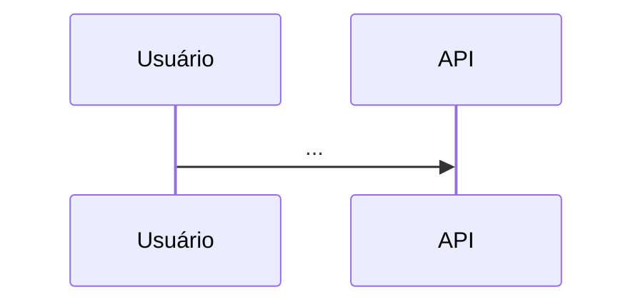

# Design: {{TITLE}}

> Mudança `{{CHANGE_ID}}` · porte {{SIZE}} · {{DATE}}
> O COMO. Respeita `.sdd/constitution.md` e os padrões que já existem no código.
> Seção que não se aplica: escreva "N/A — motivo".

## Abordagem

<!-- PREENCHA: a solução em poucos parágrafos e as alternativas descartadas. -->

## Componentes afetados

<!-- PREENCHA: arquivos/módulos novos e alterados, com caminho. Prefira estender o que existe. -->

## Fluxo

<!-- Opcional: diagrama Mermaid de sequência ou estados quando ajudar a entender.

-->

## Contratos e interfaces

<!-- PREENCHA: assinaturas, endpoints, eventos, schemas de entrada/saída e erros. -->

## Modelo de dados

<!-- PREENCHA: tabelas/coleções, migrações (compatíveis com rollback), índices, isolamento de dados. -->

## Decisões (ADRs)

<!-- PREENCHA:
### ADR-001: Título
- Contexto: ...
- Decisão: ...
- Consequências: ...
-->

## Riscos e casos extremos

<!-- PREENCHA: falhas, timeouts, concorrência, segurança e como o design trata cada um. -->

## Estratégia de testes

<!-- PREENCHA: que camada cobre cada critério de aceite (contrato, unitário, integração, UI, E2E, smoke)
e como os testes vão citar o ID do critério (ex.: it('AC-001.1: ...')). -->
